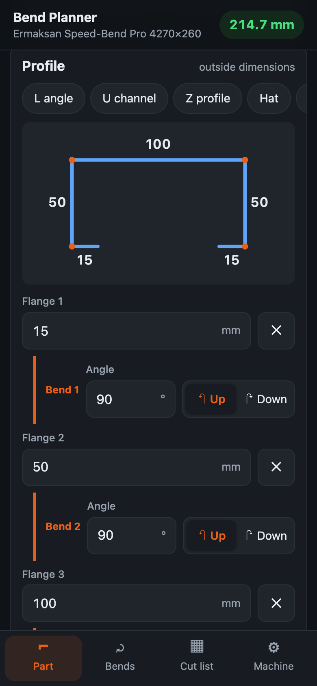
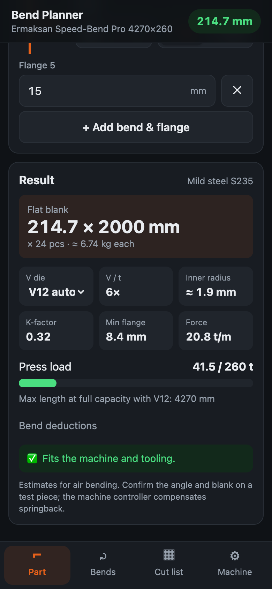
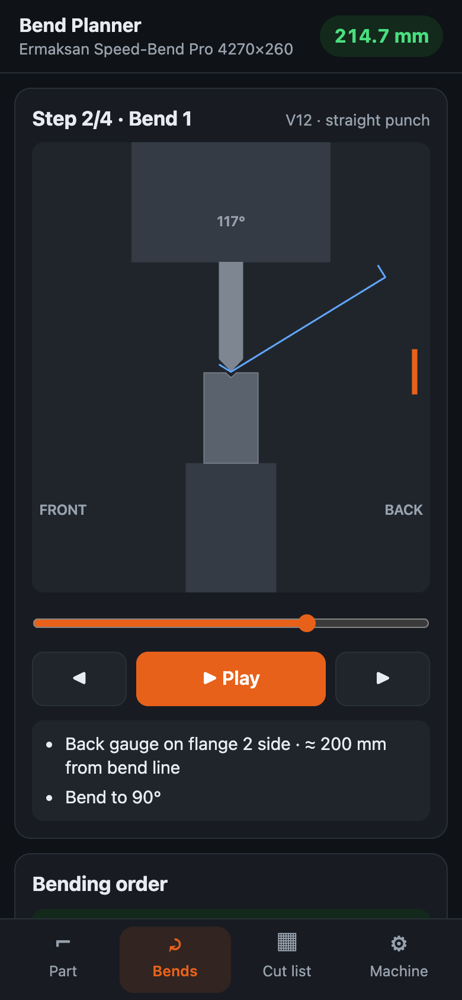
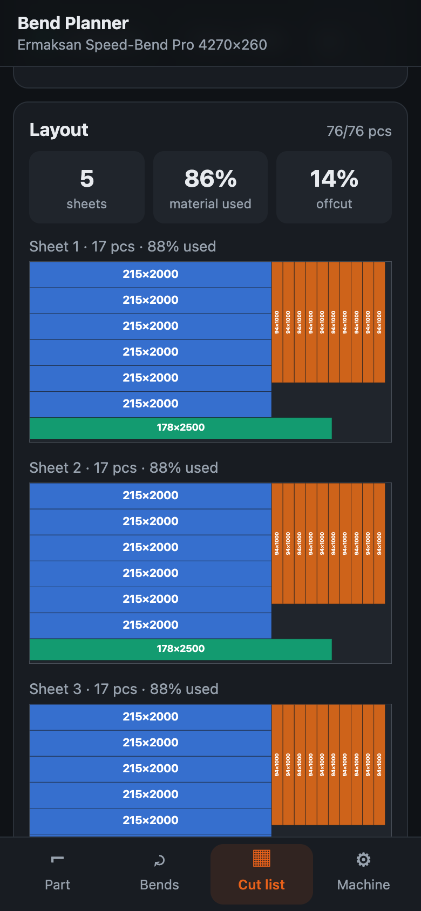
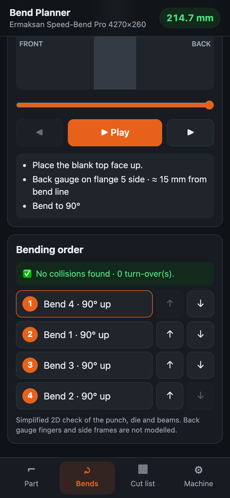
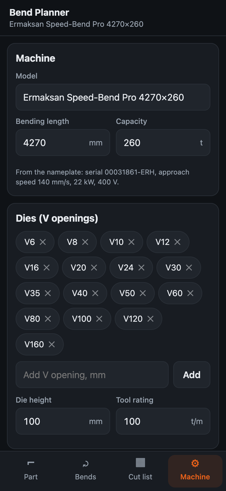

# Bend Planner

**Plan press brake work on your phone before it reaches the machine.**

**▶ Open the app:** https://marcosjfp.github.io/bend-d-metal/ (GitHub Pages) or https://bend-planner.netlify.app (Netlify). Works on any phone, installable, offline.

Bend Planner is a mobile-first web app for sheet-metal shops. You draw the cross-section of a part. The app tells you the flat blank to cut, which die to use, how much force the bend needs, and whether your press brake can do it. It then animates the bending order on the punch and die, warns about collisions, and nests every blank onto stock sheets with the least waste. It works like a cut-list optimizer, but for bending.

It ships set up for an **Ermaksan Speed-Bend Pro 4270×260** (4270 mm bending length, 260 t). Every machine, tooling and material value can be edited.

<p align="center">
  
  
  
  
</p>

---

## Why

Mistakes at the press brake are expensive: a blank cut a few millimetres wrong, a flange too short for the die, a part too heavy for the machine, or a bend order that traps the last flange against the punch. These problems are usually found on the machine, after the material has already been cut.

Bend Planner moves those checks to the planning stage, on a device the operator or planner already has in their pocket.

## Features

### 1. Part: design the profile and get the numbers


- Build the profile flange by flange: length (outside dimension), bend angle, and direction (**Up** / **Down**).
- One-tap templates: L angle, U channel, Z profile, Hat, C with lips.
- Live drawing of the finished cross-section with dimensions.
- Material, thickness (quick chips for common gauges), bend length and quantity.
- Several parts per job: add, duplicate and switch between them.


Results update as you type:

| Result | What it means |
|---|---|
| **Flat blank** | Size to cut before bending (width × bend length) and weight per piece |
| **V die** | Suggested die opening (or pick one yourself) |
| **V / t** | Die opening as a multiple of thickness |
| **Inner radius** | Expected radius in air bending |
| **K-factor** | Where the neutral axis sits, used for the blank length |
| **Min flange** | Shortest flange that still rests on the die |
| **Force** | Tons per metre of bend |
| **Press load** | Total tons compared with the machine's capacity, plus the longest bend possible at full capacity |

Problems are flagged in plain language:

- ⛔ Part longer than the machine's bending length
- ⛔ Force above the machine capacity or the tooling rating
- ⛔ Edge flange too short (it would drop into the die)
- ⚠️ Load concentrated above the evenly-spread rating (bend in the centre of the machine)
- ⚠️ V opening unusually small or large for the thickness
- ⚠️ Angle sharper than the punch (needs acute tooling)

### 2. Bends: see the bending order before you bend



- Side view of the press brake (upper beam, punch, die, lower beam) with the part placed on the die for each step.
- **Play** animates every bend; the slider scrubs through one bend.
- The app **searches for a collision-free order** with the fewest turn-overs and suggests it.
- Each step tells the operator what to do: turn the part over, swap ends, which flange goes to the back gauge and the approximate gauge distance.
- Collisions with the punch, die or beams are drawn in red and listed.
- Reorder steps by hand with ↑ / ↓ and see the effect immediately. *Use suggested* restores the computed order.
- Switch between a **straight** and a **gooseneck** punch on the Machine tab to see which parts need which tool.

### 3. Cut list: nest blanks on stock sheets


- Takes the flat blank and quantity of every part in the job.
- Stock presets (2000×1000, 2500×1250, 3000×1500, 4000×2000) or a custom size.
- Kerf / gap between parts and edge trim.
- **Shear** mode: only straight, edge-to-edge (guillotine) cuts, which a shear can actually make.
- **Laser / plasma** mode: free placement for the tightest fit.
- Optional rotation (turn it off when grain direction matters).
- Shows sheets needed, material used, offcut, and a drawing of each sheet.

### 4. Machine: your press brake, dies and materials



- Machine name, bending length and capacity, pre-filled from the nameplate.
- The V openings you own (add or remove), die height and tooling load rating.
- Punch type, tip angle, tip radius and height.
- Material library with tensile strength, radius factor and density. Comes with S235, S355, galvanized DX51D, stainless 304 and aluminium 5754.

### Built for phones

- Large touch targets, a decimal keypad for numbers, and comma or dot as the decimal separator.
- Bottom tab bar within thumb reach. Works in portrait on a small phone up to a tablet.
- Follows the phone's light / dark mode.
- **Installable and offline**: add it to the home screen and it keeps working without signal on the shop floor.
- All data stays on the device (browser storage). There are no accounts and no server.
- Small: about 80 KB gzipped.

---

## How the calculations work

All formulas are standard air-bending approximations used in sheet-metal shops. They are estimates for planning. Always confirm the angle and blank on a test piece; the machine controller handles springback.

### Bending force

```
F [kN/m] = 1.42 × Rm × t² / V
```

`Rm` = tensile strength (MPa), `t` = thickness (mm), `V` = die opening (mm).
Total tons = F × bend length (m) ÷ 9.81.

*Example:* mild steel (Rm 450), 6 mm, V48 → about 49 t/m → a 4 m bend needs about 195 t. That fits on a 260 t machine.
With 10 mm on V80 it is about 81 t/m, so only about 3.2 m can be bent at full capacity.

### Die selection

The app aims for V ≈ **6×t** (under 3 mm), **8×t** (3–10 mm), **10×t** (10–20 mm), **12×t** (over 20 mm). From the dies you own, it picks the closest one that:

1. leaves every edge flange longer than the minimum (≈ 0.7 × V),
2. keeps V between 5× and 14× the thickness,
3. stays within the tooling rating and the machine capacity.

You can always override the choice per part.

### Inner radius and K-factor

```
ri ≈ radiusFactor × V      (never smaller than the punch tip radius)
K  = 0.325 + 0.25 × log10(ri / t),  limited to 0.25 … 0.5
```

The radius factor depends on the material (≈ 0.16 for mild steel, 0.21 for stainless, 0.14 for aluminium) and can be edited.

### Flat blank

Flanges are entered as **outside dimensions**, as on most drawings. For each bend with deflection angle β = 180° − included angle:

```
bend deduction = 2 × tan(β/2) × (ri + t) − β × (ri + K × t)
flat blank     = Σ outside flanges − Σ bend deductions
```

*Example:* 3 mm mild steel L angle, 50 × 50 mm on V24 → blank ≈ 94 mm.

### Bend sequence and collision check

- The part is modelled in 2D by its centre line.
- For each step, the bend being made is placed on the die with its inside facing the punch. Bends already made keep their angle; later bends are still flat.
- The part is checked against the punch, die, upper beam and lower beam halfway through the bend and at the finished angle.
- A search over all possible orders (up to 9 bends) finds a collision-free order with the fewest turn-overs. Parts with more bends keep the drawn order and are only checked.

Not modelled: back gauge fingers, side frames, and tooling segments along the bend length.

### Nesting

Blanks are rectangles (flat width × bend length). The optimizer tries many packing strategies and keeps the one with the fewest sheets:

- several sort orders
- placement rules: best short side, best area, best long side, bottom-left
- cut directions
- first-fit or best-fit sheet choice

Shear mode only allows guillotine splits, so every cut runs edge to edge. The test suite checks that results never overlap, respect kerf and margins, and reach known optimal sheet counts.

---

## Getting started

### Use it

Open **https://marcosjfp.github.io/bend-d-metal/**, check the sample job that loads on first launch (a C channel, an angle bracket and a hat profile), then replace it with your own parts.

To install it on a phone: open the site and choose **Add to Home Screen** (Safari) or **Install app** (Chrome).

### Run it locally

Requires Node.js 20.19 or newer.

```bash
npm install
npm run dev
```

The dev server is also reachable on your local network, so you can open it on a phone connected to the same Wi-Fi: `http://<your-computer-ip>:5173`.

### Test

```bash
npm test
```

Unit tests cover the bending formulas, die selection, machine limit checks, part positioning and collision detection, and the nesting optimizer.

### Build and deploy

```bash
npm run build
```

`dist/` is a fully static site (relative paths, offline service worker). Every push to `main` runs the tests and redeploys GitHub Pages automatically ([.github/workflows/deploy.yml](.github/workflows/deploy.yml)). It is also deployed on Netlify; build and cache settings are in [netlify.toml](netlify.toml). The same folder can be hosted on Vercel or a shop server too.

---

## Project structure

```
src/
  engine/              Pure TypeScript, no UI. Tested.
    bend.ts            Force, die choice, radius, K-factor, flat blank, checks
    sequence.ts        2D posing, tool outlines, collision check, order search
    nesting.ts         Sheet nesting (guillotine and free placement)
    defaults.ts        Machine, materials, profile templates
    types.ts           Shared types
  ui/                  React components, one per tab plus shared fields and drawings
  store.ts             App state and local storage (with the first-run sample job)
  App.tsx              Tabs and layout
public/
  manifest.webmanifest, sw.js, icons   Installable / offline support
docs/screenshots/      Images used in this README
```

Stack: React, TypeScript, Vite and Vitest. There are no runtime dependencies besides React.

## Limitations

- Estimates assume **air bending**. Bottoming and coining need different forces and radii.
- The collision check is 2D and uses generic punch and die shapes. Enter your real tool heights for useful results.
- Springback is not predicted; the controller corrects the angle.
- Blanks are rectangular. Holes, notches and cut-outs are not part of the profile.
- Data lives in one browser on one device. Clearing the browser data deletes it.

## Roadmap ideas

- Share or export jobs (link, PDF job sheet, CSV cut list)
- Real tool library (punch and die profiles from catalogues)
- Translations (Portuguese, Turkish, Spanish)
- Import flat patterns from DXF
- Multi-device sync for a whole shop

## Disclaimer

Bend Planner is a planning aid. It does not replace the machine controller, the tooling manufacturer's load tables, or the operator's judgement. Always respect the safety instructions of your press brake.
